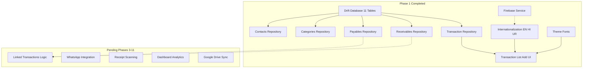

# FlowPaisa - Personal Finance & Cash Flow Manager

**Track every paisa** - A comprehensive Flutter mobile application for managing expenses, incomes, receivables, and payables.

## 🎯 Project Status

### ✅ Completed (Phase 1 - Foundation)

1. **Project Setup & Architecture**
   - Flutter project initialized with Clean Architecture
   - Riverpod 3.1.0 for state management (latest)
   - Drift (SQLite) for local database
   - Feature-first folder structure
   - Firebase Core 4.3.0 integrated

2. **Internationalization (i18n)**
   - English, Hindi (हिन्दी), and Urdu (اردو) support
   - Google Fonts 6.3.0 integration for proper script rendering
   - RTL support for Urdu
   - ARB files created for all three languages
   - Font-specific styling (Inter, Noto Sans Devanagari, Noto Nastaliq Urdu)

3. **Database Schema (Drift 2.14)**
   - Complete database with 11 tables:
     - Transactions (with linked transaction support)
     - Receivables & Payables (with external link IDs)
     - Categories (with default presets)
     - Contacts
     - Reminders
     - WhatsApp Queue
     - Usage Stats (for smart suggestions)
     - User Preferences
     - Sync Log
   - Default categories auto-populated (Food, Transport, Shopping, Bills, etc.)
   - Migration system in place

4. **Core Repositories (Phase 2 - Ready)**
   - ✅ **TransactionsRepository**: Full CRUD + date range queries
   - ✅ **ReceivablesRepository**: With auto-income creation + contact joins
   - ✅ **PayablesRepository**: With auto-expense creation + contact joins
   - ✅ **CategoriesRepository**: With usage tracking and smart suggestions
   - ✅ **ContactsRepository**: With statistics and usage tracking

5. **Transaction Management (MVP)**
   - Add transactions (Expense/Income)
   - View all transactions in a list
   - Basic transaction form with:
     - Amount input
     - Type selection (Expense/Income)
     - Description
     - Date picker
   - Repository pattern with Riverpod providers
   - Reactive UI updates via Drift streams

6. **Core UI**
   - Bottom navigation with 4 tabs (Dashboard, Transactions, Analytics, Settings)
   - Material Design 3 theme with light/dark mode
   - Responsive layouts
   - Multilingual font support

7. **Firebase Integration**
   - Firebase Core 4.3.0 initialized
   - FirebaseService for language requests
   - Graceful fallback if Firebase not configured

### 🚧 Pending (Phases 3-11)

1. **Enhanced Transaction Features**
   - Amount-first progressive disclosure UI
   - Paid FOR / Paid BY relationship logic
   - Linked transactions (Expense-Receivable, Income-Payable)
   - Category selection UI
   - Contact selection UI

2. **Receivables & Payables UI**
   - List screens with filtering
   - Add/Edit forms
   - Settlement workflow
   - Due date tracking

3. **Contacts Management**
   - Add/Edit/Delete contacts UI
   - Phone contacts import
   - Google Contacts import (Premium)
   - Contact details with statistics

4. **WhatsApp Integration**
   - Deep link generation
   - Message templates
   - Offline transaction sharing
   - Queue management

5. **Receipt Scanning**
   - Google ML Kit Text Recognition 0.15.0 (FREE, offline)
   - Camera/gallery access
   - Automatic extraction
   - Pre-fill transaction form

6. **Reminders & Notifications**
   - Local notifications (19.5.0)
   - Background jobs with WorkManager (0.9.0)
   - Smart reminder suggestions
   - Due date alerts

7. **Dashboard & Analytics**
   - Overview cards
   - 5 basic charts with fl_chart 1.1.1 (FREE)
   - Smart insights
   - CSV export (FREE)

8. **Premium Features**
   - Google Sign-In 7.2.0
   - Google Drive encrypted backup (googleapis 15.0.0)
   - PDF reports with charts
   - Advanced analytics
   - Excel export

9. **Cross-Platform**
   - Web responsiveness
   - Windows desktop adaptation

## 🏗️ Architecture



### Tech Stack
- **Framework:** Flutter 3.13.9
- **Language:** Dart 3.1.5
- **State Management:** Riverpod 3.1.0 (upgraded from 2.4.0)
- **Database:** Drift 2.14.0 (SQLite wrapper)
- **Architecture:** Clean Architecture with feature-first structure
- **Firebase:** Core 4.3.0, Firestore 6.1.1 (upgraded from 2.x/4.x)

### Project Structure
```
lib/
├── core/
│   ├── database/          # Drift database setup
│   ├── firebase/          # Firebase service ✨ NEW
│   ├── theme/             # App theme & fonts
│   ├── constants/         # App constants
│   └── utils/             # Helper functions
├── features/
│   ├── transactions/      # Transaction CRUD ✅
│   │   ├── data/         # Repository ✅
│   │   └── presentation/ # UI ✅
│   ├── receivables/       # Receivables ✨ NEW
│   │   └── data/         # Repository ✅
│   ├── payables/          # Payables ✨ NEW
│   │   └── data/         # Repository ✅
│   ├── contacts/          # Contacts ✨ NEW
│   │   └── data/         # Repository ✅
│   ├── categories/        # Categories ✨ NEW
│   │   └── data/         # Repository ✅
│   ├── dashboard/         # Dashboard & analytics
│   ├── auth/              # Google Sign-In
│   ├── premium/           # Premium features
│   ├── reminders/         # Reminder system
│   ├── whatsapp/          # WhatsApp integration
│   └── receipt_scan/      # Receipt scanning
├── shared/
│   ├── widgets/           # Reusable widgets
│   └── providers/         # Global providers
│       ├── database_provider.dart ✅
│       └── firebase_provider.dart ✨ NEW
├── l10n/                  # Localization files
│   ├── app_en.arb         # English
│   ├── app_hi.arb         # Hindi
│   └── app_ur.arb         # Urdu
└── main.dart              # ✅ Firebase initialized
```

## 🚀 Getting Started

### Prerequisites
- Flutter SDK 3.13.9 or higher
- Dart SDK 3.1.5 or higher
- Android Studio / VS Code
- Android SDK (for Android development)

### Installation

1. Clone the repository:
```bash
git clone <repository-url>
cd cashbook
```

2. Install dependencies:
```bash
flutter pub get
```

3. Generate localization files:
```bash
flutter gen-l10n
```

4. Generate Drift database code:
```bash
flutter pub run build_runner build --delete-conflicting-outputs
```

5. Run the app:
```bash
flutter run
```

## 📱 Features Overview

### Current (MVP)
- ✅ Add Expense/Income transactions
- ✅ View transaction list
- ✅ Multi-language support (EN, HI, UR)
- ✅ Dark/Light theme
- ✅ Local SQLite database
- ✅ Firebase integration (language requests)
- ✅ All core repositories implemented

### Planned
- 🚧 Linked transactions (Paid FOR/BY)
- 🚧 Receivables & Payables tracking
- 🚧 WhatsApp notifications
- 🚧 Receipt scanning (OCR)
- 🚧 Dashboard with charts
- 🚧 CSV/PDF export
- 🚧 Google Drive backup
- 🚧 Smart reminders

## 📦 Dependencies

### Core (Upgraded ✨)
- `flutter_riverpod: ^3.1.0` (was 2.4.0) - State management
- `drift: ^2.14.0` - SQLite wrapper
- `google_fonts: ^6.3.0` - Multilingual fonts
- `intl: any` - Internationalization

### Firebase (Upgraded ✨)
- `firebase_core: ^4.3.0` (was 2.24.0)
- `cloud_firestore: ^6.1.1` (was 4.14.0)

### Features (Upgraded ✨)
- `google_mlkit_text_recognition: ^0.15.0` (was 0.11.0) - Receipt OCR
- `image_picker: ^1.0.7` - Camera access
- `fl_chart: ^1.1.1` (was 0.65.0) - Charts & visualizations
- `csv: ^6.0.0` - CSV export
- `pdf: ^3.10.0` - PDF generation
- `google_sign_in: ^7.2.0` (was 6.1.0) - Google authentication
- `googleapis: ^15.0.0` (was 11.4.0) - Google Drive API
- `flutter_secure_storage: ^10.0.0` (was 9.0.0)
- `flutter_local_notifications: ^19.5.0` (was 17.0.0)
- `workmanager: ^0.9.0+3` (was 0.5.2)
- `share_plus: ^12.0.1` (was 7.2.0)
- `flutter_lints: ^6.0.0` (was 2.0.0) - Latest linting rules

### Development (Upgraded ✨)
- `riverpod_generator: ^4.0.0+1` (was 2.2.0)
- `riverpod_lint: ^3.1.0` (was 2.2.0)

## 🧪 Testing

Run tests:
```bash
flutter test
```

Run analysis:
```bash
flutter analyze
```

## 📄 License

This project is private and not licensed for public use.

## 🤝 Contributing

This is a private project. Contributions are not accepted at this time.

## 📞 Contact

For questions or issues, please contact the project maintainer.

---

**FlowPaisa** - Track every paisa 💰

1. **Enhanced Transaction Features**
   - Amount-first progressive disclosure UI
   - Paid FOR / Paid BY relationship logic
   - Linked transactions (Expense-Receivable, Income-Payable)
   - Auto-create matching entries on settlement
   - Category selection
   - Contact selection

2. **Receivables & Payables**
   - Full CRUD operations
   - Due date tracking
   - Reminder system
   - Auto-income creation when receivable is settled
   - Auto-expense creation when payable is paid (optional)

3. **Contacts Management**
   - Add/Edit/Delete contacts
   - Phone contacts import
   - Google Contacts import (Premium)
   - Usage statistics for smart suggestions

4. **WhatsApp Integration**
   - Deep link generation for shared transactions
   - Message templates
   - Offline transaction sharing
   - Viral marketing links
   - Queue management

5. **Receipt Scanning**
   - Google ML Kit Text Recognition (FREE, offline)
   - Camera/gallery access
   - Automatic amount extraction
   - Date and merchant extraction
   - Pre-fill transaction form

6. **Reminders & Notifications**
   - Local notifications
   - Background jobs with WorkManager
   - Smart reminder suggestions
   - Due date alerts

7. **Dashboard & Analytics**
   - Overview cards (Net Balance, Receivables, Payables)
   - 5 basic charts (FREE):
     - Expense by Category (Pie Chart)
     - Income vs Expense (Bar Chart)
     - Cash Flow Trend (Line Chart)
     - Receivables vs Payables
     - Top Contacts
   - Smart insights
   - CSV export (FREE)

8. **Premium Features**
   - Google Sign-In
   - Google Drive encrypted backup
   - PDF reports with charts
   - Advanced analytics
   - Budget tracking
   - Excel export
   - Scheduled reports

9. **Cross-Platform**
   - Web responsiveness
   - Windows desktop adaptation

## 🏗️ Architecture

### Tech Stack
- **Framework:** Flutter 3.13.9
- **Language:** Dart 3.1.5
- **State Management:** Riverpod 2.4.x
- **Database:** Drift 2.14.0 (SQLite wrapper)
- **Architecture:** Clean Architecture with feature-first structure

### Project Structure
```
lib/
├── core/
│   ├── database/          # Drift database setup
│   ├── theme/             # App theme & fonts
│   ├── constants/         # App constants
│   └── utils/             # Helper functions
├── features/
│   ├── transactions/      # Transaction CRUD
│   ├── receivables/       # Receivables management
│   ├── payables/          # Payables management
│   ├── contacts/          # Contact management
│   ├── categories/        # Category management
│   ├── dashboard/         # Dashboard & analytics
│   ├── auth/              # Google Sign-In
│   ├── premium/           # Premium features
│   ├── reminders/         # Reminder system
│   ├── whatsapp/          # WhatsApp integration
│   └── receipt_scan/      # Receipt scanning
├── shared/
│   ├── widgets/           # Reusable widgets
│   └── providers/         # Global providers
├── l10n/                  # Localization files
│   ├── app_en.arb         # English
│   ├── app_hi.arb         # Hindi
│   └── app_ur.arb         # Urdu
└── main.dart
```

## 🚀 Getting Started

### Prerequisites
- Flutter SDK 3.13.9 or higher
- Dart SDK 3.1.5 or higher
- Android Studio / VS Code
- Android SDK (for Android development)

### Installation

1. Clone the repository:
```bash
git clone <repository-url>
cd cashbook
```

2. Install dependencies:
```bash
flutter pub get
```

3. Generate localization files:
```bash
flutter gen-l10n
```

4. Generate Drift database code:
```bash
flutter pub run build_runner build --delete-conflicting-outputs
```

5. Run the app:
```bash
flutter run
```

## 📱 Features Overview

### Current (MVP)
- ✅ Add Expense/Income transactions
- ✅ View transaction list
- ✅ Multi-language support (EN, HI, UR)
- ✅ Dark/Light theme
- ✅ Local SQLite database

### Planned
- 🚧 Linked transactions (Paid FOR/BY)
- 🚧 Receivables & Payables tracking
- 🚧 WhatsApp notifications
- 🚧 Receipt scanning (OCR)
- 🚧 Dashboard with charts
- 🚧 CSV/PDF export
- 🚧 Google Drive backup
- 🚧 Smart reminders

## 📦 Dependencies

### Core
- `flutter_riverpod: ^2.4.0` - State management
- `drift: ^2.14.0` - SQLite wrapper
- `google_fonts: ^6.1.0` - Multilingual fonts
- `intl: any` - Internationalization

### Features
- `firebase_core: ^2.24.0` - Firebase integration
- `cloud_firestore: ^4.14.0` - Language requests storage
- `google_mlkit_text_recognition: ^0.11.0` - Receipt OCR
- `image_picker: ^1.0.7` - Camera access
- `fl_chart: ^0.65.0` - Charts & visualizations
- `csv: ^6.0.0` - CSV export
- `pdf: ^3.10.0` - PDF generation
- `google_sign_in: ^6.1.0` - Google authentication
- `googleapis: ^11.4.0` - Google Drive API

## 🧪 Testing

Run tests:
```bash
flutter test
```

Run analysis:
```bash
flutter analyze
```

## 📄 License

This project is private and not licensed for public use.

## 🤝 Contributing

This is a private project. Contributions are not accepted at this time.

## 📞 Contact

For questions or issues, please contact the project maintainer.

---

**FlowPaisa** - Track every paisa 💰
